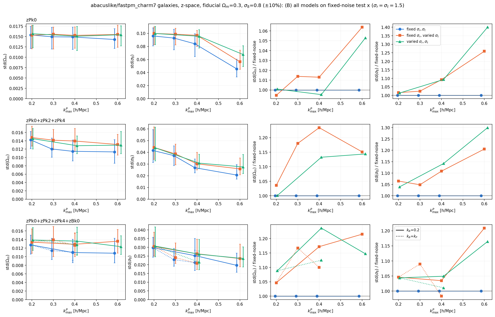
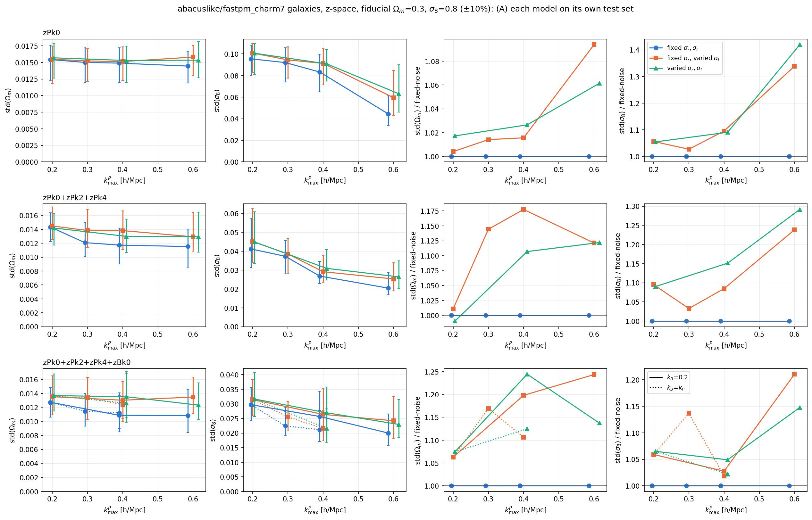

# How much does marginalizing over the noise nuisance widen the cosmology posterior?

**Date**: 2026-10-19
**Type**: Self-consistent, noise-marginalization inflation
**Train / Test**: abacuslike fastpm_charm7 (galaxy), self-consistent; four model sets that differ only in how the observational noise is treated
**Summaries**: zPk0; zPk0+zPk2+zPk4; zPk0+zPk2+zPk4+zBk0
**kmax**: zPk 0.2–0.6; zBk 0.2–0.4 (see `config.md`)
**Notes**: Fixed-noise value σ_rad = σ_tran = 1.5 Mpc/h, inside the logU(0.1, 4.51) prior and close to the effective Abacus noise found on 2026-09-28. Stdevs are medians over 78 fiducial test rows (24 lhids); ratios in (B) are per-row medians, since every model sees the same rows.

Two measurements:
- **(B), headline**: every model is sampled (2000 draws) on the *same* test inputs, the fixed-noise suite's x at σ_rad = σ_tran = 1.5. Differences between models are then only how they treat the noise.
- **(A)**: each model's own validation samples on its own test set, so for the marginalized models the std is also averaged over the test-set noise draws.

---

## Summary

- **The inflation is modest, 0–25% in std, and grows with kmax.** At kmax = 0.2 every summary is within 0–9% of the fixed-noise width. At zPk024 kmax 0.4 it is +11–23%; at kmax 0.6 it is +15% in Ωm and +21–30% in σ8.
- **Varying σ_tran alone accounts for nearly all of it.** Outside the under-trained reparam kmax=0.3 cuts, the σ_tran-only model (orange) and the fully marginalized models (green in the figures; reparam in the table) are within 0.15 of each other in ratio, and the σ_tran-only ratio is the larger one about as often as the smaller. The reparam and non-reparam case-3 models, trained on identical data, differ by up to 0.11 themselves. The one consistent pattern is σ8 at zPk kmax 0.6 without the bispectrum, where the σ_tran-only ratio is lower than both fully marginalized ones (zPk0: 1.26 vs 1.34–1.40; zPk024: 1.21 vs 1.25–1.30); elsewhere no cell shows a systematic extra cost from also varying σ_rad.
- **Ωm and σ8 respond differently by summary.** For zPk0, the Ωm width is unchanged (≤ 6%) at every kmax, while σ8 inflates from 1.01–1.03 at 0.2 to 1.26–1.40 at 0.6. For zPk024 and +zBk0, Ωm inflates by 1.10–1.24 once zPk kmax ≥ 0.4, while σ8 stays at 0.98–1.05 for the bispectrum cuts (0.2, 0.2), (0.4, 0.2) and (0.4, 0.4).
- **(A) and (B) agree** to within about 0.05 in ratio in most cells (largest gap 0.08), so evaluating at σ = 1.5 is representative of the noise-averaged width.
- **The reparam zPk024 and +zBk0 kmax=0.3 cuts are outliers** (ratios 1.24–1.48), consistent with their short Optuna runs; the σ_tran-only model at the same cuts has ratios 1.05–1.18. Treat them as under-trained, not as a noise effect. The figures therefore show only the non-reparam case-3 models (which have no kmax=0.3 cut); the reparam numbers stay in the table and the `.npz`.

## (B) Common fixed-noise inputs

Median std ×10³ and per-row median ratio to the fixed-noise model (trans = σ_tran-only, rep = reparam, non = non-reparam). The std axes in the figures start at 0.

| summary | kmax | std(Ωm) fixed | Ωm ratio trans / rep / non | std(σ8) fixed | σ8 ratio trans / rep / non |
|---|---|---|---|---|---|
| zPk0 | 0.2 | 15.4 | 0.99 / 0.99 / 1.00 | 96.0 | 1.02 / 1.03 / 1.01 |
| zPk0 | 0.3 | 14.9 | 1.01 / 1.04 / – | 92.7 | 1.02 / 1.07 / – |
| zPk0 | 0.4 | 14.9 | 1.01 / 1.00 / 1.00 | 84.0 | 1.09 / 1.11 / 1.09 |
| zPk0 | 0.6 | 14.3 | 1.06 / 1.03 / 1.05 | 45.7 | 1.26 / 1.34 / 1.40 |
| zPk024 | 0.2 | 14.2 | 1.04 / 1.01 / 1.00 | 41.5 | 1.06 / 1.02 / 1.04 |
| zPk024 | 0.3 | 12.0 | 1.18 / 1.48* / – | 37.2 | 1.05 / 1.36* / – |
| zPk024 | 0.4 | 11.5 | 1.23 / 1.15 / 1.13 | 26.8 | 1.11 / 1.11 / 1.14 |
| zPk024 | 0.6 | 11.3 | 1.15 / 1.15 / 1.14 | 20.6 | 1.21 / 1.25 / 1.30 |
| +zBk0 | P0.2 B0.2 | 12.8 | 1.05 / 1.03 / 1.09 | 29.8 | 1.05 / 1.05 / 1.04 |
| +zBk0 | P0.3 B0.3 | 11.4 | 1.17 / 1.43* / – | 22.9 | 1.09 / 1.24* / – |
| +zBk0 | P0.4 B0.2 | 11.0 | 1.17 / 1.13 / 1.24 | 25.2 | 1.03 / 1.00 / 1.05 |
| +zBk0 | P0.4 B0.4 | 11.0 | 1.10 / 1.15 / 1.12 | 21.2 | 0.98 / 1.04 / 1.01 |
| +zBk0 | P0.6 B0.2 | 10.8 | 1.21 / 1.13 / 1.15 | 19.6 | 1.21 / 1.17 / 1.16 |

\* reparam kmax=0.3 models with 57–77 Optuna trials.

- **The fixed-noise model keeps gaining from higher kmax where the marginalized ones flatten.** For zPk024, std(σ8) falls 26.8 → 20.6 (−23%) from kmax 0.4 to 0.6 at fixed noise, against 29.7–30.7 → 25.8–27.5 (−10 to −14%) for the marginalized models. For zPk0, std(σ8) falls 84 → 46 (−46%) against 96–98 → 56–68 (−29 to −42%).
- **Ωm in the P(k)-only cuts plateaus at kmax ≥ 0.4 in every case.** The fixed-noise std(Ωm) for zPk024 is 11.5 at 0.4 and 11.3 at 0.6; the marginalized models sit at 12.8–13.9 and 12.9–13.1.
- **Adding zBk0 to the same kmax as zPk removes most of the σ8 inflation.** At (0.4, 0.4) the σ8 ratios are 0.98–1.04, against 1.11–1.14 for zPk024 alone at 0.4. Ωm still inflates by 1.10–1.15 there.
- **The 16–84% spread across the 78 rows is wider than most of the inflation.** The per-row ratios in (B) are paired, so the medians above are more precise than the overlapping error bars in the left panels suggest.

## (A) Own test sets

- The ratios follow (B) closely. The largest differences are zPk0 kmax 0.6, where the σ8 ratio is 1.34–1.42 in (A) against 1.26–1.40 in (B), and zPk024 kmax 0.2, where σ8 is 1.07–1.10 in (A) against 1.02–1.06 in (B).
- The absolute fixed-noise stds in (A) match (B) to within 3% in every cell (Ωm within 0.2×10⁻³, σ8 within 1.2×10⁻³), as expected, since that model sees the same x in both and only the posterior draws differ.

## Caveats

- One fixed value (σ = 1.5) was tested; the cost of marginalizing may differ at other noise levels.
- The two case-3 model sets are trained on identical data and differ by up to 0.11 in ratio (+zBk0 P0.4 B0.2 Ωm: 1.13 vs 1.24 in (B)). Differences between noise treatments smaller than this are within training-to-training variation.
- TARP at zPk024 kmax 0.4 is slightly overconfident for both new models, by a similar amount.
